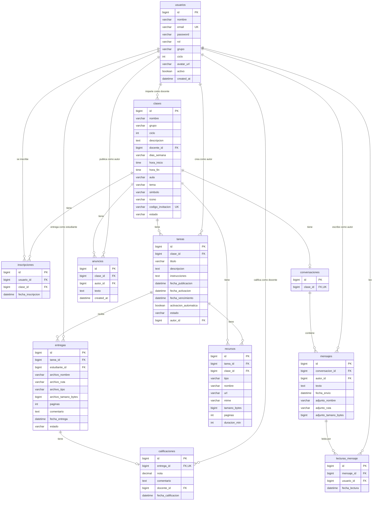

# AULIX


**AULIX** es una plataforma web para la gestión de clases escolares. Los **docentes** crean clases, publican tareas y anuncios, reciben entregas, califican y se comunican con sus grupos; los **estudiantes** se unen a sus clases con un código de invitación, entregan tareas, consultan sus calificaciones y su calendario, y participan en la conversación grupal de cada clase. Todo con autenticación segura mediante JWT (y login con Google), control de acceso basado en roles y paginación del lado del servidor.

Equipo [11].

---

##  Equipo

| Integrante | Usuario GitHub | Rol en el Proyecto |
| :--- | :--- | :--- |
| **jiménez Mendoza Eduardo** | [@evkaal](https://github.com/evkaal) | Backend (Spring Boot + MySQL), despliegue en VPS |
| **Garcia Ciseneros Jonathan** | [@LianDev1](https://github.com/LianDev1) | Frontend (React + Vite) y diseño (Figma, logo) |

---

##  Enlaces del Proyecto

* **Aplicación en producción (HTTPS):** https://aulix.study
* **URL Base de la API (Producción):** https://aulix.study/api
* **URL Base de la API (Local):** http://localhost:8106/api
* **Tablero Kanban (GitHub Projects):** 
* **Prototipo Navegable en Figma:** https://www.figma.com/design/zk7Dpc586o43BKXATSCpTd/Sin-t%C3%ADtulo?node-id=0-1&p=f&t=Bx5Eyn52wJJXbJTX-0

---

##  Stack Tecnológico

| Capa | Tecnologías |
| :--- | :--- |
| **Frontend** | React 19.3.1, Vite 8.3.8, React Router DOM 7.18.5, Lucide React, CSS3 responsivo |
| **Backend** | Java 21, Spring Boot 4.1.2, Spring Security, Spring Data JPA (Hibernate), Bean Validation, JJWT 0.12.6, Lombok, google-api-client 2.7.1 |
| **Base de Datos** | MySQL 8 (`aulix_db`) |
| **Correo** | Resend API (dominio `aulix.study` verificado, remitente `AULIX <noreply@aulix.study>`) |
| **Pruebas de API** | Bruno (colección versionada en `backend/bruno/`, entornos local y VPS) |
| **Despliegue** | VPS Ubuntu, Nginx, `systemd`, Let's Encrypt (Certbot HTTPS) |

---

##  Estructura del Repositorio

```text
AULIX/
├── README.md
├── backend/                    # Proyecto Spring Boot (Maven)
│   ├── src/main/java/com/aulix/aulix/
│   │   ├── entity/             # 11 entidades JPA + enums (Rol, EstadoTarea, ...)
│   │   ├── repository/         # 11 repositorios JPA (uno por entidad)
│   │   ├── dto/                # Requests/responses (records, nunca se expone password)
│   │   ├── service/            # AuthService, ClaseService, TareaService, EntregaService,
│   │   │                       #   CalificacionService, MensajeService, DashboardService,
│   │   │   │                       #   CalendarioService, ArchivoService, EmailService,
│   │   │   │                       #   SecurityHelper, TareaScheduler, DatabaseSeeder
│   │   ├── controller/         # Auth, Dashboard, Clase, Tarea, Entrega,
│   │   │                       #   Calificacion, Mensaje, Calendario, Archivo
│   │   ├── security/           # JwtService, JwtAuthenticationFilter, SecurityConfig
│   │   ├── config/             # ApplicationConfig (UserDetailsService, BCrypt, CORS)
│   │   └── exception/          # GlobalExceptionHandler (401/403/404/400/422)
│   ├── src/main/resources/
│   │   └── application.properties   # Solo placeholders ${...}, sin valores reales
│   ├── bruno/                  # Colección Bruno (auth, clases, tareas, entregas,
│   │                           #   calificaciones, mensajes, calendario, dashboard,
│   │                           #   archivos + environments local y vps)
│   ├── deploy/                 # aulix.service, crear-bd.sql, .env.example, desplegar-vps.sh
│   ├── frontend-patch/         # authService.js y classService.js ya adaptados
│   ├── mvnw / mvnw.cmd
│   └── pom.xml
├── frontend/                   # Aplicación React + Vite
│   ├── src/
│   │   ├── pages/              # Login, Registro, Inicio, MisClases, Tareas,
│   │   │                       #   Calificaciones, Calendario, Mensajes, Configuracion...
│   │   ├── components/         # Navbar, Sidebar, ProtectedRoute, ConfirmModal,
│   │   │                       #   FormField, Avatar...
│   │   ├── context/            # AuthContext (sesión y token JWT)
│   │   ├── services/           # authService, classService, validators...
│   │   ├── hooks/ / utils/ / styles/ / assets/   # logo-aulix.png y recursos
│   │   ├── App.jsx / main.jsx / theme.js
│   ├── public/
│   ├── package.json / vite.config.js / index.html
│   └── README-FRONTEND.md
└── .gitignore
```

---

##  Modelo de Datos (Diagrama ER)

El esquema tiene **11 tablas** en MySQL 

Las relaciones de muchos a muchos (N:M) se modelan con **entidades de unión explícitas**, que es el modelado correcto cuando la unión tiene atributos propios:

* **Usuario ↔ Clase** se resuelve con `inscripciones` (tiene `fecha_inscripcion` y es única por pareja usuario + clase).
* **Mensaje ↔ Usuario** se resuelve con `lecturas_mensaje` (marca de lectura, con `fecha_lectura`).

El rol es una columna `enum` (`DOCENTE` / `ESTUDIANTE`) dentro de `usuarios`; 




##  Roles, Permisos y Credenciales de Prueba


| Recurso | `DOCENTE` | `ESTUDIANTE` |
| :--- | :---: | :---: |
| Clases | Crea y gestiona **sus propias** clases | Se une con código de invitación; solo ve las clases donde está inscrito |
| Tareas | Crea, edita y elimina en sus clases | Ve las tareas de sus clases y entrega |
| Entregas | Ve y califica las entregas de sus clases | Entrega sus tareas; solo ve sus propias entregas |
| Calificaciones (0–10) | Crea y edita | Solo consulta las suyas |
| Anuncios y recursos | Publica en sus clases | Solo consulta |
| Mensajes | Conversación grupal de cada clase | Conversación grupal de cada clase |
| Calendario | Horario y tareas de sus clases | Horario y tareas de sus clases |
| Gestión de usuarios | No (rol `ADMIN` pendiente) | No |

### Usuarios de prueba 

Las cuentas semilla se crean automáticamente al arrancar el backend. La contraseña es la misma para todos los estudiantes de prueba:

| Rol | Nombre | Correo electrónico | Contraseña |
| :--- | :--- | :--- | :--- |
| **DOCENTE** | Laura Martínez | `laura@colegio.edu` | `Docente123*` |
| **ESTUDIANTE** | Ana Sofía García (3° A) | `ana.sofia@colegio.edu` | `Estudiante123*` |
| **ADMINISTRADOR** | — PENDIENTE: el rol aún no existe — | — | — |

Los demás estudiantes de prueba (3° A y 3° B) usan el correo `nombre.apellido@colegio.edu` (ej. `estudiante-3a-09@colegio.edu`) con la contraseña `Estudiante123*`. Los códigos de invitación de las clases semilla son `MAT-3A-2026`, `CIE-3A-2026` y `LEN-3B-2026`.

> Las contraseñas de prueba se guardan cifradas con BCrypt en la base de datos; las de arriba son solo las credenciales de demostración del entorno de prueba, no de producción.

---

##  Instalación y Ejecución Local

### Prerrequisitos

* **Java 21** (JDK 21)
* **Node.js 20+** y **npm**
* **Docker** (para el MySQL local) o **MySQL 8.0+** instalado
* **Maven** (incluido como wrapper `mvnw` / `mvnw.cmd` en el backend)

### 1. Clonar el repositorio

```bash
git clone https://github.com/evkaal/AULIX.git
cd AULIX
```

### 2. Preparar la base de datos MySQL (Docker)

El backend usa por defecto `aulix_db` en MySQL 8. En local corre en un contenedor aparte (`mysql-aulix`, puerto del host **3308**):

```bash
docker run --name mysql-aulix -e MYSQL_ROOT_PASSWORD=TU_PASSWORD -p 3308:3306 -v aulix-mysql-data:/var/lib/mysql -d mysql:8.0
```

La base `aulix_db` se crea sola al arrancar el backend (`createDatabaseIfNotExist=true` en la URL JDBC).

### 3. Configurar y ejecutar el Backend (Spring Boot)

En PowerShell, desde `backend` (usa las variables de entorno; ningún valor real va en el repositorio):

```powershell
cd backend
$env:DB_URL = "jdbc:mysql://localhost:3308/aulix_db?createDatabaseIfNotExist=true&serverTimezone=America/Mexico_City"
$env:DB_USER = "root"
$env:DB_PASS = "TU_PASSWORD"
$env:JWT_SECRET = "TU_JWT_SECRET"
.\mvnw.cmd spring-boot:run
```

Variables de entorno del backend (ver `backend/src/main/resources/application.properties` y `backend/deploy/.env.example`):

| Variable | Descripción |
| :--- | :--- |
| `PORT` | Puerto del backend (por defecto `8106`) |
| `DB_URL` | URL JDBC de MySQL (por defecto `localhost:3306/aulix_db`) |
| `DB_USER` / `DB_PASS` | Usuario y contraseña de MySQL |
| `JWT_SECRET` | Secreto para firmar los tokens JWT (obligatorio, sin valor por defecto; generarlo con `openssl rand -base64 32`) |
| `JWT_EXPIRATION` | Duración del token en ms (por defecto `86400000`, 24 h) |
| `UPLOAD_DIR` | Carpeta de archivos subidos (por defecto `./uploads`) |
| `GOOGLE_CLIENT_ID` | Client ID de OAuth de Google Cloud (login con Google; si está vacío, `POST /api/auth/google` responde 400) |
| `RESEND_API_KEY` | Clave API de Resend (correo de bienvenida) |
| `EMAIL_FROM` | Remitente del correo (por defecto `AULIX <onboarding@resend.dev>`; en producción `AULIX <noreply@aulix.study>`) |

Para compilar el JAR:

```powershell
.\mvnw.cmd clean package -DskipTests
```

El JAR queda en `backend/target/aulix-0.0.1-SNAPSHOT.jar`.

### 4. Configurar y ejecutar el Frontend (React + Vite)

En otra terminal, desde `frontend`:

```powershell
cd frontend
copy .env.example .env
npm install
npm run dev
```

La aplicación estará disponible en **`http://localhost:5173`**. Variables del frontend (`.env.example`): `VITE_API_URL` (por defecto `http://localhost:8106/api`), `VITE_DEMO_MODE` (`false` = backend real) y `VITE_DEMO_FALLBACK`.

---


##  Endpoints Principales de la API

Todas las rutas protegidas requieren el encabezado `Authorization: Bearer <token>`.

### Autenticación (`/api/auth`)

* `POST /api/auth/register` — Registro de usuario (`201 Created`). Contraseña fuerte: mínimo 8 caracteres, mayúscula, minúscula, número y carácter especial.
* `POST /api/auth/login` — Inicio de sesión (`200 OK`, devuelve JWT).
* `POST /api/auth/google` — Inicio de sesión con Google (ID token de Google Identity Services; si el correo existe entra con su rol, si no se crea como `ESTUDIANTE`).
* `GET /api/auth/me` — Información del usuario autenticado.
* `POST /api/auth/change-password` — Cambio de contraseña (requiere token).
* `POST /api/auth/test-email` — Correo de prueba con Resend (solo `DOCENTE`).

### Clases, tareas, entregas y calificaciones

* `GET /api/clases` — Clases del docente o donde está inscrito el estudiante. `POST /api/clases`, `GET/PUT/DELETE /api/clases/{id}`, `POST /api/clases/unirse` (código de invitación), `GET /api/clases/{id}/alumnos` (paginado).
* `GET /api/tareas` (docente) / `GET /api/estudiante/tareas` — Tareas. `POST/PUT/DELETE /api/tareas[/{id}]`, `PUT /api/tareas/{id}/programacion`.
* `POST /api/tareas/{id}/entregas` — Entregar tarea (archivo de hasta 20 MB + comentario).
* `POST/PUT /api/entregas/{id}/calificacion` — Calificar (nota 0–10). `GET /api/estudiante/calificaciones`, `GET /api/calificaciones/resumen`, `GET /api/calificaciones/exportar` (CSV).

### Mensajes, calendario y dashboard

* `GET /api/mensajes/conversaciones`, `GET /api/mensajes/conversaciones/{claseId}/mensajes` (paginado), `POST .../mensajes`, `POST .../leido`, `GET /api/mensajes/sin-leer`.
* `GET /api/calendario?mes=&materiaId=` / `GET /api/estudiante/calendario?mes=`.
* `GET /api/docente/resumen`, `GET /api/estudiante/resumen`.

---

## Pruebas con Bruno

El repositorio incluye la colección de **Bruno** versionada en `backend/bruno/` (36 peticiones: `auth`, `clases`, `tareas`, `entregas`, `calificaciones`, `mensajes`, `calendario`, `dashboard`, `archivos` + entornos `local` y `vps`):

1. Abrir **Bruno** y elegir **Open Collection**.
2. Cargar la carpeta `backend/bruno/`.
3. Elegir el entorno (`local` o `vps`).
4. Empezar por `auth/login-docente`, que guarda el token JWT para el resto de las peticiones; `auth/sin-token` comprueba el caso de error `401` sin token.


**Justificación (teoría del color):** la paleta es una armonía análoga fría (azules y verdes). El azul es el color de la confianza y la calma, adecuado para un entorno escolar donde el alumno debe sentirse seguro; el verde menta transmite crecimiento y aprendizaje, y el morado aporta creatividad, por eso identifica a Lengua y Literatura. Cada materia tiene su propio color (Matemáticas azul, Ciencias verde, Lengua morado), así el estudiante identifica de un vistazo a qué clase pertenece cada tarjeta o tarea sin leer el texto. El texto principal es gris pizarra (`#5A6B80`) sobre fondos casi blancos (`#F4F7FB`), con contraste alto para que se lea bien en móvil y en escritorio; el rojo solo se usa para errores y acciones destructivas, nunca como color decorativo, para que no pierda su significado de alerta.

---

## Medidas de Seguridad Implementadas

* Contraseñas cifradas con **BCrypt** (validación de complejidad en frontend y backend: mínimo 8 caracteres, mayúscula, minúscula, número y carácter especial).
* Autenticación **stateless** con JWT (expiración 24 h) enviado en el header `Authorization: Bearer <token>` en cada petición protegida.
* Autorización por rol en la capa de servicio (el docente solo gestiona sus propias clases; el estudiante solo ve sus datos).
* Manejo centralizado de errores en JSON (`@ControllerAdvice` / `@RestControllerAdvice`) con códigos HTTP correctos (400, 401, 403, 404, 422, 500), sin exponer trazas ni entidades JPA directamente.
* Las respuestas usan DTOs; las entidades JPA nunca se exponen directamente y la contraseña nunca sale en JSON (`@JsonIgnore`).
* Secretos y credenciales solo por variables de entorno (fuera del control de versiones): `application.properties` solo tiene placeholders `${...}`.

